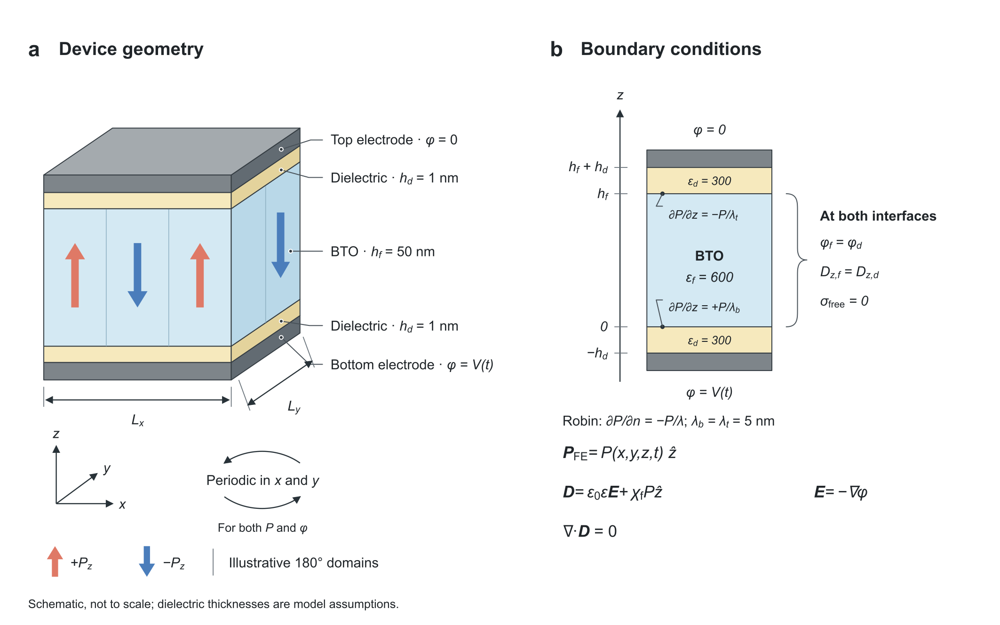

# tdgl3d

3D time-dependent Ginzburg–Landau (TDGL, Model A) simulation of a ferroelectric capacitor: a scalar out-of-plane polarization P_z(x, y, z) in a ferroelectric film between two dielectric layers and two electrodes, with fully self-consistent electrostatics through the stack. It is built to study switching, retention and depolarization-driven domain formation in thin BaTiO₃-like films, including the effect of pinning defects.

- **Physics:** Landau P²–P⁴–P⁶ free energy, anisotropic gradient energy, Robin/Neumann surface conditions, depolarization from finite dielectric layers, applied voltage waveforms, optional noise.
- **Numerics:** Fourier (periodic) in x and y, conservative cell-centered electrostatics through the nonuniform stack in z, exponential time differencing (ETD2) with the linear gradient + electrostatic operator integrated exactly.
- **Defects:** random Gaussian pinning sites with locally scaled α₁ (fixed or randomly distributed strength and size).
- **Workflow:** one notebook drives every waveform; results are cached by a hash of all physical and numerical inputs, so reruns only redraw figures. Command-line scripts run matched comparisons and parameter sweeps and export MP4 videos of P, E and φ in three cross sections.

<p align="center"></p>

## Quick start

```bash
git clone https://github.com/YuejunShen/tdgl3d.git
cd tdgl3d
python -m venv .venv && source .venv/bin/activate
pip install -e ".[notebook]"
jupyter lab 3D_TDGL.ipynb        # edit the parameter cell, then Run All
```

`ffmpeg` on your `PATH` is needed only for MP4 export. Run the tests with:

```bash
python -m unittest discover -s tests -v
```

Using the solver directly:

```python
import numpy as np
from tdgl3d import Material, Grid, StackModel

model = StackModel(Material(lambda_bottom=5e-9, lambda_top=5e-9),
                   Grid(nx=64, ny=64, nz=32, nd=2, Lx=32e-9, Ly=32e-9))
times = np.linspace(0, 10*model.m.t0, 101)
result = model.simulate(lambda t: 0.4, times, P0=model.uniform_initial(-1))
print(result['P'][-1])   # mean polarization, C/m²
```

## Repository layout

```
tdgl3d/
├── tdgl3d/
│   ├── solver.py          Material, Grid, NucleationSite (defect sites), StackModel
│   └── animations.py      cross-section reconstruction, HTML viewers, MP4 export
├── 3D_TDGL.ipynb          main notebook: parameters, waveforms, runner, plots
├── scripts/
│   ├── animate_cross_sections.py   HTML + MP4 for the notebook's case (--run to simulate)
│   ├── compare_cases.py            two matched variants: --compare gradient | pinning
│   ├── sweep_cases.py              N variants, e.g. --dielectric-nm 0 0.5 1 2 3 4
│   ├── compare_robin_domains.py    Neumann vs Robin spontaneous domain formation
│   └── compare_poisson_fenicsx.py  independent FEniCSx check of the electrostatics
├── tests/                 physics and notebook-driver tests
├── docs/
│   ├── figures/           device schematic
│   └── verification/      saved verification results
└── tools/strip_notebook_outputs.py   git filter that commits the notebook without outputs
```

## Model

The free energy is F = ∫ [α₁P²/2 + α₁₁P⁴/4 + α₁₁₁P⁶/6 + G₁₁(∂P/∂z)²/2 + G₄₄|∇ₓᵧP|²/2] dV plus the electrostatic energy of the stack at prescribed electrode voltage. P relaxes as ∂P/∂t = −γ δF/δP (+ noise), with the field obtained from ∇·(ε₀ε∇φ) = ∇·P in every step.

- P is scalar P_z, so the model describes 180° domains. It excludes polarization rotation, elasticity and leakage.
- Boundaries are periodic in x and y. Electrodes hold potentials V(t) and 0. Potential and normal displacement are continuous across insulating interfaces.
- `Material.lambda_bottom` / `lambda_top` set the extrapolation length at each ferroelectric face: `None` for Neumann, a positive length for Robin (∂P/∂n = −P/λ with outward normal n), `0` for P = 0 at the face. The boundary energy is included in `energy_per_area`.
- Time is measured in t₀ = 1/(γ|α₁|); about 54 µs for the default (illustrative) mobility.
- `h_d` is the thickness of **each** dielectric layer; `h_d = 0` gives ideal electrodes.

The default coefficients are standard BaTiO₃ Landau and gradient coefficients (α₁ = −1.8558×10⁷, α₁₁ = −2.097×10⁸, α₁₁₁ = 1.0352×10¹⁰ in SI; G₁₁ = 2×10⁻¹⁰, G₄₄ = 1×10⁻¹¹ V m³/C; ε_FE = 600, ε_DE = 300). Mobility and the 1 nm dielectric layers are modeling assumptions. Quantitative domain sizes and time scales need calibration and grid/time-step convergence checks.

## The notebook

Edit the parameter cell of [3D_TDGL.ipynb](3D_TDGL.ipynb) and Run All. It groups material coefficients, geometry and grid, initial state, waveform, defects, noise and time stepping, and plot/video settings.

| `waveform["kind"]` | Behavior |
|---|---|
| `zero` | Zero-voltage relaxation for `relaxation_t0` |
| `step_hold` | Apply `amplitude_V` suddenly and hold for `hold_t0` |
| `hold_release` | Hold, remove the voltage suddenly, then relax (time zero = removal) |
| `triangle`, `sine` | Bipolar cycles of `period_t0`, optional zero-voltage relaxation |
| `trapezoid` | Rise, hold, fall, relax |
| `two_step` | Two voltage levels, fall, relax |
| `pund` | P/U/N/D pulse blocks with current subtraction |
| `custom` | Your time/voltage knots, linear or held between knots |

- **Initial state:** `near_zero` (small correlated perturbation), `positive` or `negative`. P evolves continuously across waveform pieces.
- **Noise:** `noise_over_Ps` adds an independent Gaussian kick per cell and step, with rms `noise_over_Ps`·Ps·√(Δt/t₀). It seeds nucleation and is not a thermal bath; `StackModel.simulate(temperature=…)` provides fluctuation–dissipation noise instead.
- **Pinning sites:** `defects["pinning"]` places `count` random 3D Gaussian sites (fixed `seed`) in which only α₁ is scaled, to `alpha1_factor`·α₁ at the center. `alpha1_factor` and `radius_nm` are each a number (identical sites) or a `[low, high]` range sampled per site (`*_dist`: `"uniform"` or `"loguniform"`). Per-site values are written to `sites.json`. With `count = 0` there are no sites.

### Saved runs

Every physical/numerical configuration gets its own folder `runs/<kind>_<hash>/`. Identical settings reload the saved dynamics; plot-only changes never rerun a simulation (`reuse_cache=False` forces it). A folder contains `run.json` (full configuration and solver hash), `phase_*.npz` (SI traces and 3D P snapshots) and, after plotting:

- diagnostics, rate, histogram and summary figures;
- `cross_sections/cross_sections.html`: synchronized interactive x–y, x–z and y–z viewers of P, E and φ;
- `cross_sections/cross_sections.mp4`: rows P_z, E_z, |E|, φ (labeled on the left), columns x–y, x–z, y–z, a waveform strip with V(t) and mean P, and site outlines when defects are present. Each panel has its own fixed color scale taken from its ferroelectric cells; the thin dielectric layers may saturate;
- `cross_sections/orthogonal_fields.npz`: the exact float32 cross sections in SI units.

Traces keep both sides of ideal voltage jumps, so timestamps can repeat at phase boundaries; use `J_total` and `dPdt` rather than differentiating endpoint arrays.

## Scripts

All scripts read the notebook's parameter cell and share its cache. JSON options override notebook settings without editing it.

```bash
# HTML viewers and MP4 for the notebook's case (simulate first if not cached)
python scripts/animate_cross_sections.py --fps 12 --run

# Pulse and release, with vs without pinning sites
python scripts/compare_cases.py --compare pinning \
    --waveform '{"kind": "hold_release", "hold_t0": 10, "relaxation_t0": 100}' \
    --simulation '{"snapshot_dt_t0": 0.5}' \
    --defects '{"pinning": {"count": 64, "alpha1_factor": [2, 18], "radius_nm": [0.5, 2]}}'

# With vs without the gradient term (G11 = G44 = 0)
python scripts/compare_cases.py --compare gradient

# Dielectric-thickness sweep
python scripts/sweep_cases.py --dielectric-nm 0 0.5 1 2 3 4 \
    --waveform '{"kind": "hold_release", "hold_t0": 10, "relaxation_t0": 100}' \
    --simulation '{"snapshot_dt_t0": 0.5}'
```

Comparison and sweep folders (`runs/<compare>_comparison_*`, `runs/sweep_*`) hold mean-P traces, relaxation figures (linear and log time, plus P − P∞ with an exponential-tail fit for runs that settle), final domain snapshots, side-by-side MP4s and `summary.json`. `--plots-only` redraws figures from cache.

## Verification

`tests/` checks the uniform limit, Gauss's law and electrode potentials, energy derivatives and decay, time-step refinement, noise covariance and reproducibility, state continuation, PUND charge accounting, and waveform jumps and caching.

`scripts/compare_poisson_fenicsx.py` compares `StackModel.electrostatics` with an independent 3D Q2 finite-element solution of the same layered Poisson problem. It needs a separate dolfinx environment (e.g. `mamba create -n fenicsx -c conda-forge python=3.11 fenics-dolfinx mpich numpy scipy`) and writes `docs/verification/verification_poisson_fenicsx.json`.

## Contributing

The notebook is committed without outputs. After cloning, enable the filter once so your own outputs stay local:

```bash
git config filter.strip-notebook.clean "python3 tools/strip_notebook_outputs.py"
git config filter.strip-notebook.smudge cat
```

## License

MIT — see [LICENSE](LICENSE).
